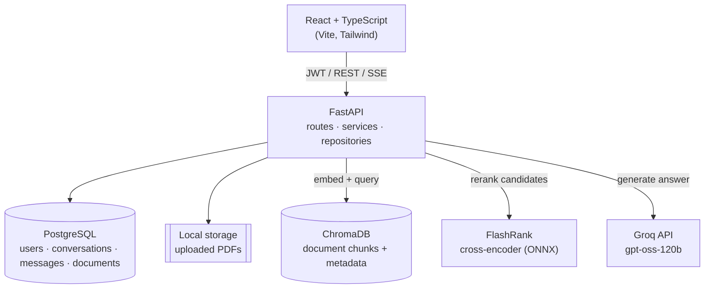
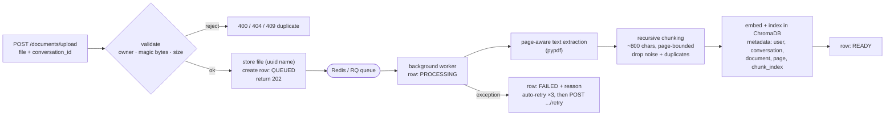
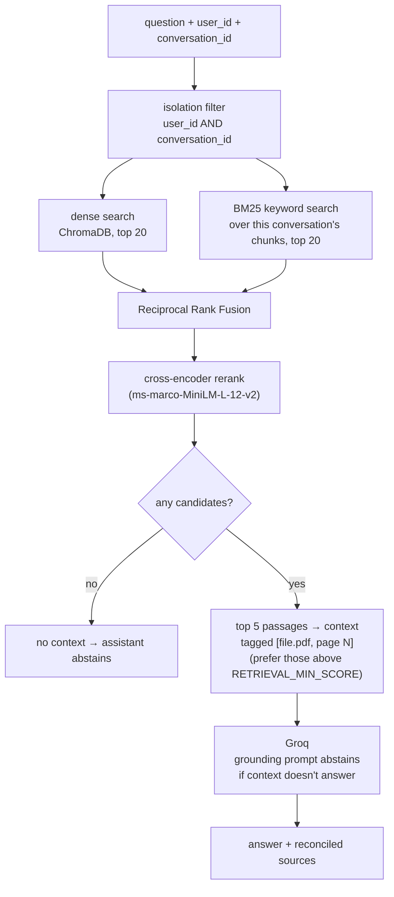
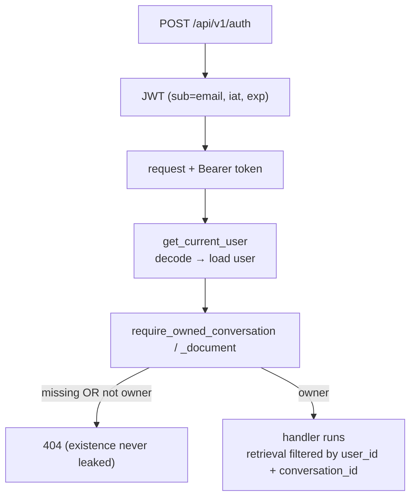

# AI Customer Support Platform

[](https://github.com/Emonemon74/ai-customer-support-platform/actions/workflows/ci.yml)

A multi-user support assistant that answers questions from uploaded PDFs. Every
answer is grounded in retrieved document passages and cites the source
document and page; when the documents don't contain the answer, the assistant
says so instead of guessing.

This repository is also a worked example of the engineering *around* an LLM
feature: conversation-scoped data isolation with tests, a hybrid
retrieval + reranking pipeline, an automated retrieval/answer evaluation
harness with measured before/after numbers, and CI.

---

## Contents

- [What it does](#what-it-does)
- [Architecture](#architecture)
- [Document ingestion](#document-ingestion)
- [Retrieval pipeline](#retrieval-pipeline)
- [Grounded answers](#grounded-answers)
- [Evaluation](#evaluation)
- [Authentication & data isolation](#authentication--data-isolation)
- [Security](#security)
- [Observability](#observability)
- [API reference](#api-reference)
- [Local development](#local-development)
- [Testing & CI](#testing--ci)
- [Configuration](#configuration)
- [Project structure](#project-structure)
- [Deployment](#deployment)
- [Roadmap](#roadmap)

---

## What it does

- **Accounts & conversations** — unified login/signup (JWT), plus create /
  search / rename / delete of conversations.
- **Document upload** — PDFs are validated (magic-byte sniffing, not just the
  browser's `Content-Type`), stored, parsed page-by-page, chunked, embedded,
  and indexed in ChromaDB.
- **Grounded chat** — questions retrieve passages scoped to the current user
  *and* conversation, an answer is generated from only those passages, and the
  response streams back over Server-Sent Events with a citation list.
- **Honest refusals** — when the documents don't answer the question the
  assistant returns a fixed "not found in your documents" message and no
  sources (measured: 100% on the eval's unanswerable questions).
- **React dashboard** — responsive sidebar, markdown + code rendering,
  streaming, per-answer source chips.

## Architecture



The backend is layered: `api/` (HTTP) → `services/` (business logic) →
`repositories/` (data access) → `models/`. Retrieval and LLM code lives in
`app/ai/`.

## Document ingestion



Upload returns `202` immediately with a `QUEUED` document; parsing, chunking and
embedding run in a background [RQ](https://python-rq.org/) worker so a large PDF
never blocks the request. The job is idempotent and retried automatically;
`POST /documents/{id}/retry` re-queues a `FAILED` one. The frontend polls
`GET /documents` and shows per-document status. Duplicate uploads (same bytes,
same conversation) are rejected with `409`.

For a quick local run without Redis, set `DOCUMENT_QUEUE_ASYNC=false` (the
default) and the same pipeline runs inline during the upload request.

Every chunk carries `user_id`, `conversation_id`, `document_id`, `page_number`
and `chunk_index` so retrieval can filter by owner and cite by page.

## Retrieval pipeline



`RETRIEVAL_MODE` selects how far the pipeline runs — `vector`, `hybrid`, or
`rerank` (default). The BM25 index is built on demand from the conversation's
own chunks (small corpora, always current, nothing extra to maintain).

Retrieval results are cached (in-process, TTL + LRU) keyed by a per-conversation
version that bumps on every upload / delete, so a repeated question skips the
dense + BM25 + rerank work and a stale answer is never served after the
documents change. Cache hit/miss ratio is in `/metrics`.

| Setting | Default | Meaning |
| --- | --- | --- |
| `RETRIEVAL_MODE` | `rerank` | `vector` \| `hybrid` \| `rerank` |
| `RETRIEVAL_DENSE_K` | `20` | dense candidates before fusion |
| `RETRIEVAL_BM25_K` | `20` | keyword candidates before fusion |
| `RETRIEVAL_RRF_K` | `60` | RRF constant |
| `RETRIEVAL_TOP_N` | `5` | passages passed to the LLM |
| `RERANKER_MODEL` | `ms-marco-MiniLM-L-12-v2` | FlashRank cross-encoder |
| `RETRIEVAL_MIN_SCORE` | `0.15` | rerank score that marks a passage "clearly relevant" |

The cross-encoder is a strong *ranker* but a noisy *classifier* — it scores
short factual lines, name headers and vague "summarize this" queries well below
`RETRIEVAL_MIN_SCORE` even when the passages are right. So when a conversation's
documents return any candidates, the top few are passed as context (preferring
those above the threshold) and the grounding prompt decides whether they
actually answer the question. Context is withheld entirely only when retrieval
comes back empty. The eval confirms the trade-off: over-abstention dropped to
**0.00** while correct abstention on unanswerable questions stayed at **1.00**.

## Grounded answers

- The system prompt tells the model to answer **only** from the provided
  context and to append the matching `[filename, page N]` tag after each
  supported sentence.
- After generation, `reconcile_sources` compares the answer text to each
  retrieved source tag (tolerating Unicode bracket / space variants) and
  returns **only the sources the model actually cited** — invented citations
  are dropped, and an abstention returns an empty source list.
- Document context and conversation history are fenced as untrusted material;
  the prompt explicitly forbids following instructions found inside them, and a
  test injects a jailbreak string to confirm it never reaches the system role.

## Evaluation

`backend/eval/` is a reproducible benchmark: it ingests a 6-document corpus
under a reserved sentinel user and scores retrieval (and, optionally, answers)
against `dataset.jsonl` (44 questions, 7 unanswerable).

```bash
cd backend
uv run python -m eval.run_eval                 # retrieval metrics
uv run python -m eval.run_eval --with-answers  # + LLM-graded answer quality
```

Latest results on the bundled corpus ([`backend/eval/results.md`](backend/eval/results.md)):

| Mode | Recall@3 | MRR | p50 latency |
| --- | --- | --- | --- |
| vector-only (baseline) | 0.97 | 0.953 | 75 ms |
| + hybrid (BM25) | 1.00 | 0.955 | 76 ms |
| + hybrid + rerank | 1.00 | **0.986** | 247 ms |

Answer quality of the `rerank` pipeline (LLM-graded): **source accuracy 1.00**
(cited the expected document + page), **correct abstention 1.00** on
unanswerable questions, **over-abstention 0.00**. The corpus is small so
Recall@5 saturates — the differentiators are ranking quality (MRR) and the
ability to decline. See [`backend/eval/README.md`](backend/eval/README.md).

## Authentication & data isolation



Every conversation- or document-scoped endpoint funnels through
`app/core/authz.py`. A resource that doesn't exist and one owned by someone
else both return **404** — a `403` would confirm the id exists. The same
`user_id + conversation_id` filter is enforced on every vector query and
delete, with ids coerced to `int` so a type mismatch can't silently disable
it. `backend/tests/test_security.py` covers the cross-tenant cases (read,
upload, rename, delete, retrieval leakage), asserting both the status code and
that the victim's data is untouched.

## Security

- **Uploads** — MIME allow-list *and* magic-byte check; size capped while
  streaming to disk; empty / mismatched files rejected; UUID filenames.
- **Auth** — bcrypt password hashing; JWT with `iat` and a 1-day default TTL.
- **AI** — prompt-injection guard over retrieved content; relevance threshold
  prevents empty-context generation; error responses on the chat stream are
  generic (no internal detail leaked).
- **Rate limiting** — per-IP fixed-window limits on the auth (10/min) and chat
  (30/min) endpoints; `429` with a generic message when exceeded.
- **Headers** — `X-Content-Type-Options`, `X-Frame-Options: DENY`,
  `Referrer-Policy`, `Cross-Origin-Opener-Policy`, `Permissions-Policy` on every
  response.
- **CORS** — origin allow-list via `BACKEND_CORS_ORIGINS`.

## Observability

- **Request ids** — every request gets an `X-Request-ID` (accepted from the
  client if present, generated otherwise) and it is echoed on the response.
- **Structured logs** — every log line carries `req`, `user` and `conv`;
  background jobs bind their own `req` + `job_id`. The chat path logs
  retrieval latency, LLM latency, prompt/completion tokens and whether the
  model abstained; ingestion logs chunk count and processing time.
- **`GET /metrics`** — a plain-text snapshot (Prometheus format) of in-process
  counters: HTTP requests/errors by status, chat answers by outcome, LLM
  tokens, retrieval cache hit/miss, plus count/sum summaries for request,
  retrieval and LLM latency.

Kept dependency-free on purpose — a full OpenTelemetry/Prometheus/Grafana
stack is a later step, once there's somewhere to ship it. The counters are
per-process, so `/metrics` reflects the API process; the worker's
document-processing numbers are in its structured logs (a shared metrics store
comes with that later step).

## API reference

All paths are prefixed with `/api/v1` except `/health`. Protected routes
require `Authorization: Bearer <token>`.

| Method | Path | Description |
| --- | --- | --- |
| `GET` | `/health` | Health check |
| `POST` | `/auth` | Login or signup → `{ access_token }` |
| `GET` | `/users/me` | Current user |
| `POST` | `/conversations` | Create conversation (title auto-generated) |
| `GET` | `/conversations` | List the caller's conversations |
| `GET` | `/conversations/search?q=` | Search by title |
| `GET` | `/conversations/{id}/messages` | Message history |
| `PATCH` | `/conversations/{id}` | Rename |
| `DELETE` | `/conversations/{id}` | Delete (cascades documents + messages) |
| `POST` | `/documents/upload` | Upload a PDF into a conversation |
| `GET` | `/documents?conversation_id=` | List documents in a conversation |
| `GET` | `/documents/{id}?conversation_id=` | Document detail |
| `DELETE` | `/documents/{id}?conversation_id=` | Delete a document |
| `POST` | `/chat/ask` | Non-streaming answer `{ answer, sources }` |
| `POST` | `/chat/stream` | SSE stream: `sources` → `token`… → `sources` → `done` |

Interactive docs at `/docs` when the server is running.

## Local development

**Prerequisites:** [uv](https://docs.astral.sh/uv/), Node 22+. PostgreSQL is
recommended; SQLite works for a quick start.

### Backend

```bash
cd backend
uv sync
cp .env.example .env          # then edit — see Configuration below
uv run alembic upgrade head
uv run uvicorn app.main:app --reload --port 8000
```

`curl http://127.0.0.1:8000/health` → `{"status":"healthy"}`.

To exercise the async ingestion path locally, run Redis and a worker and set
`DOCUMENT_QUEUE_ASYNC=true`:

```bash
docker run -p 6379:6379 redis:7-alpine   # or a local redis-server
DOCUMENT_QUEUE_ASYNC=true uv run python -m app.worker.main
```

On the first chat request the ChromaDB embedding model (~80 MB) and the
FlashRank reranker (~90 MB) download and cache to disk.

### Frontend

```bash
cd frontend
npm install
cp .env.example .env          # VITE_API_BASE_URL=http://127.0.0.1:8000
npm run dev                    # http://localhost:5173
```

## Testing & CI

```bash
cd backend
uv run pytest                  # 49 tests: auth, isolation, chunking,
                               # live-Chroma retrieval, answer grounding
uv run ruff check .
```

```bash
cd frontend
npm run lint
npm run build
```

[`.github/workflows/ci.yml`](.github/workflows/ci.yml) runs all of the above on
every push to `main` / `feature/**` and on pull requests. The tests need no
secrets — pypdf, ChromaDB and Groq are stubbed, and the suite runs against an
in-memory SQLite database.

## Configuration

`backend/.env`:

| Variable | Required | Default | Notes |
| --- | --- | --- | --- |
| `GROQ_API_KEY` | yes | — | from [console.groq.com](https://console.groq.com) |
| `DATABASE_URL` | yes | — | `postgresql://…` or `sqlite:///./ai_support.db` |
| `SECRET_KEY` | yes | — | long random string for JWT signing |
| `GROQ_MODEL` | no | `openai/gpt-oss-120b` | any chat model on your key |
| `ACCESS_TOKEN_EXPIRE_MINUTES` | no | `1440` | JWT lifetime |
| `BACKEND_CORS_ORIGINS` | no | localhost:5173 | comma-separated allow-list |
| `REDIS_URL` | no | `redis://localhost:6379/0` | queue broker |
| `DOCUMENT_QUEUE_ASYNC` | no | `false` | `true` = process uploads in the worker |
| `RATE_LIMIT_ENABLED` | no | `true` | per-IP fixed-window limiting |
| `RATE_LIMIT_AUTH_PER_MINUTE` | no | `10` | auth endpoint budget |
| `RATE_LIMIT_CHAT_PER_MINUTE` | no | `30` | chat endpoint budget |
| `RETRIEVAL_*` | no | see table above | retrieval tuning |

`frontend/.env`: `VITE_API_BASE_URL` — the backend origin only (API paths are
added by the client).

## Project structure

```text
.
├── .github/workflows/ci.yml
├── docker-compose.yml
├── backend/
│   ├── Dockerfile
│   ├── app/
│   │   ├── ai/            # parser, chunker, vector_store, hybrid_retriever,
│   │   │                  # reranker, rag, llm
│   │   ├── api/v1/        # auth, users, conversations, documents, chat, health
│   │   ├── core/          # settings, authz, security (jwt/password), exceptions
│   │   ├── db/            # engine + session
│   │   ├── models/        # SQLAlchemy: user, conversation, message, document
│   │   ├── repositories/  # data access
│   │   ├── schemas/       # Pydantic request/response
│   │   ├── services/      # auth, conversation, document, chat
│   │   └── worker/        # RQ queue + document-processing job
│   ├── alembic/           # migrations
│   ├── eval/              # retrieval + answer evaluation harness
│   └── tests/             # pytest suite
└── frontend/             # + Dockerfile, nginx.conf
    └── src/
        ├── api/           # Axios client
        ├── components/    # chat/, document/, layout/
        ├── pages/         # Login, Dashboard
        └── services/      # typed API wrappers
```

## Deployment

### Docker Compose (local / single box)

```bash
cp .env.example .env          # set GROQ_API_KEY and SECRET_KEY
docker compose up --build     # frontend on http://localhost:8080
```

Six services: `frontend` (nginx serving the built SPA and proxying `/api`),
`backend` (uvicorn, runs `alembic upgrade head` on start), `worker` (RQ),
`postgres`, `redis`, and `chroma` (vector store as a server — the API and the
worker are separate processes and can't share an embedded Chroma, so
`CHROMA_HOST` points them both at this container). Raw uploads sit on the
`uploads_data` volume shared by `backend` + `worker`; vectors on `chroma_data`.

For a non-container single box, `ecosystem.json` runs the backend, worker and
frontend preview with PM2.

### AWS

Planned: ECS/Fargate for `backend` + `worker`, RDS Postgres, ElastiCache Redis,
Chroma on Fargate with an EFS volume (or a hosted vector DB), EFS for the shared
upload volume, the SPA on S3 + CloudFront.

## Roadmap

- [x] Dockerfiles + `docker-compose` (managed Postgres, persistent volume for
      `chroma_db`)
- [ ] Deploy to AWS
- [x] Asynchronous ingestion (queue + worker) so large PDFs don't block upload
- [x] Structured request logging with request/user/conversation ids and
      retrieval/LLM latency, plus a `/metrics` snapshot
- [ ] Ship metrics/traces to a real backend (OpenTelemetry → Prometheus/Grafana)
- [ ] Per-message citation history (sources currently reflect the latest answer)
- [ ] Larger evaluation corpus and an LLM-judge answer grader
```
