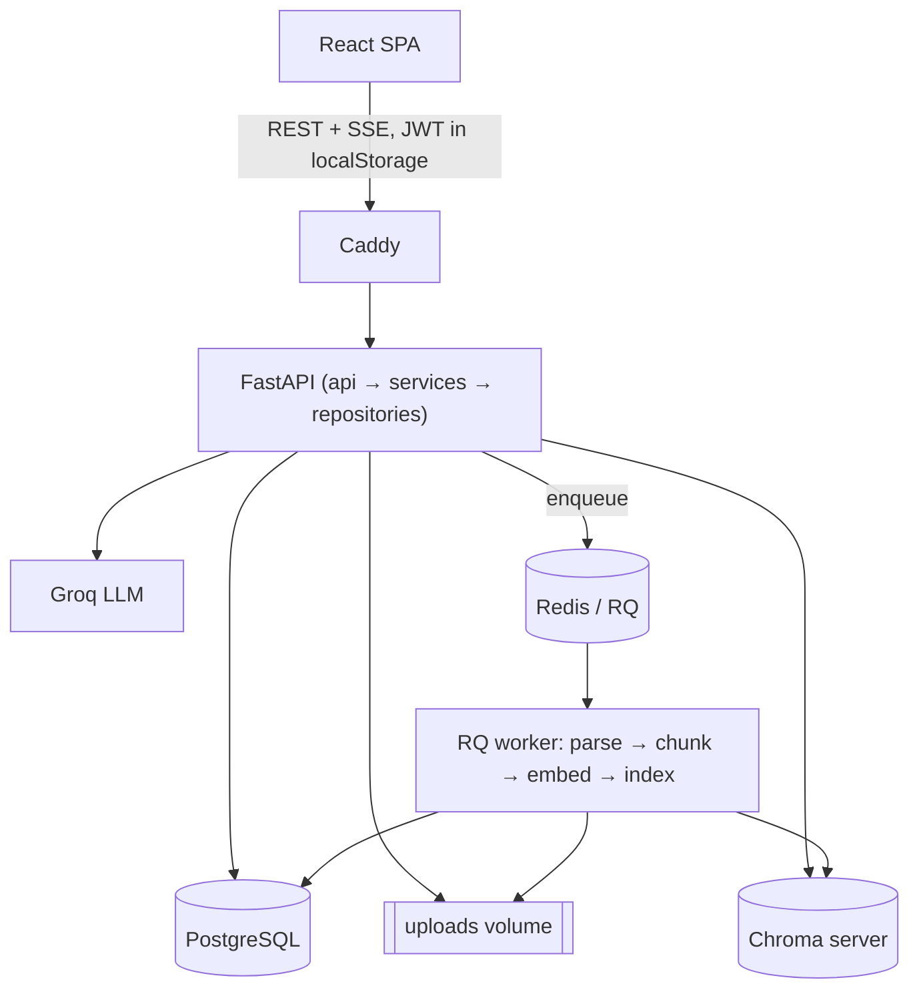
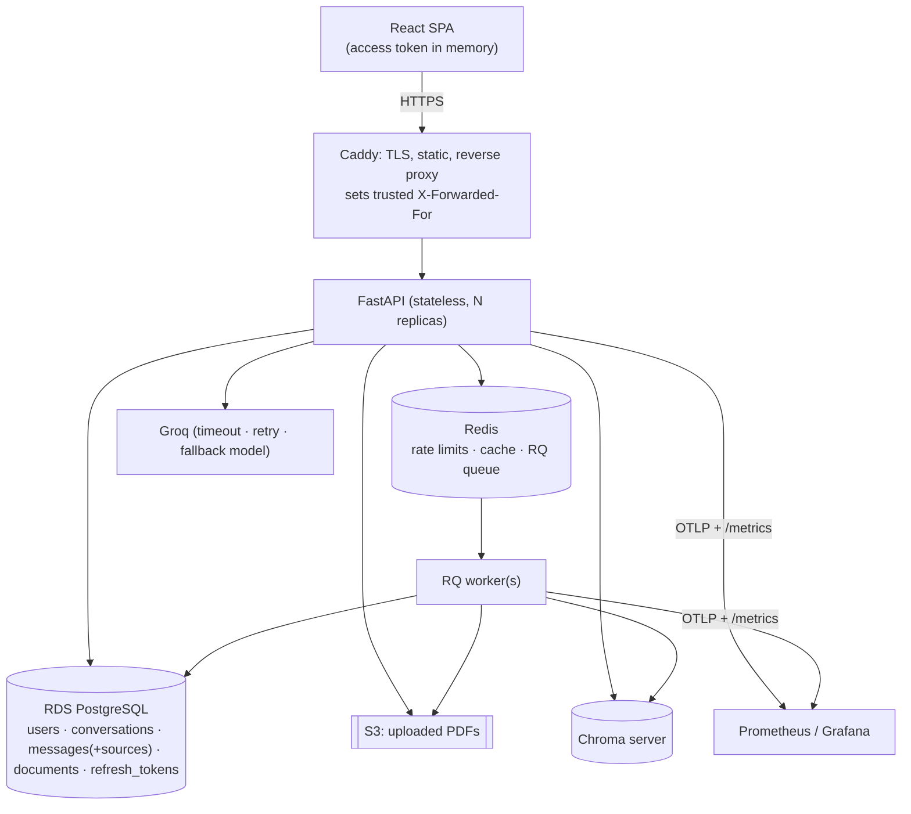

# System Design & Target Architecture

Status: **proposal**. Describes the system as it is on `feature/security-and-retrieval`,
the gaps found in review, and the target design with a phased plan.

## 1. Goals and non-goals

**Goals**
- Answers grounded in the user's own PDFs, with durable citations.
- Strict per-user and per-conversation isolation.
- Safe to run on the public internet (abuse limits, hardened auth, secrets handling).
- Horizontally scalable stateless API; reproducible deploy; measurable quality (eval).

**Non-goals (for now)**
- Multi-tenant organisations / RBAC, billing, non-PDF ingestion, fine-tuning.
- Kubernetes. One host is enough until load proves otherwise.

**Sizing assumptions** (drive the choices below): tens of users, hundreds of
documents, <5 concurrent chats. Chat latency is dominated by the LLM (seconds);
retrieval is ~250 ms with reranking.

## 2. Current architecture



Per-process state that does **not** survive a second API replica:
the rate limiter (`core/ratelimit.py`) and the retrieval cache (`ai/cache.py`).

## 3. Gaps this design addresses

| # | Gap | Where | Risk |
|---|-----|-------|------|
| G1 | Assistant messages store no sources | `models/message.py` | Citations vanish on reload |
| G2 | `X-Forwarded-For` trusted unconditionally | `core/ratelimit.py` | Rate-limit bypass / lockout |
| G3 | Rate limiter + cache in process memory | `core/ratelimit.py`, `ai/cache.py` | Limits/caches diverge per replica |
| G4 | `DEBUG=True` default | `core/settings.py` | Unsafe by default in prod |
| G5 | Access token in `localStorage` | `frontend/src` | XSS ⇒ token theft |
| G6 | `frontend/dist/` committed | repo | Noisy diffs, stale artifacts |
| G7 | Uploads on one host's disk | compose volume | Blocks multiple API/worker hosts |
| G8 | No LLM timeout/retry/fallback or history budget | `ai/llm.py`, `chat_service.py` | Hung streams, unbounded prompt |
| G9 | No frontend tests, no coverage, no dep audit | CI | Regressions unseen |

(`refresh_tokens` already exists as a table and migration; check whether it is wired up before building G5.)

## 4. Target architecture



### 4.1 Request flow: grounded chat (SSE)

```mermaid
sequenceDiagram
    participant U as Browser
    participant A as API
    participant R as Redis
    participant V as Chroma + reranker
    participant L as LLM
    participant D as Postgres
    U->>A: POST /chat/stream (Bearer / cookie)
    A->>R: rate-limit check (INCR key, per user+IP)
    A->>D: verify conversation ownership; save USER message
    A->>R: cache lookup (conv_version, question)
    A->>V: hybrid retrieve → rerank → score gate
    A-->>U: event: sources (retrieved)
    A->>L: stream (context + trimmed history), timeout/retry
    L-->>A: tokens
    A-->>U: event: token …
    A->>D: save ASSISTANT message + final sources (JSONB)
    A-->>U: event: sources (cited) · done
```

### 4.2 Key decisions

**D1. Persist citations on the message (fixes G1).**
Add `messages.sources JSONB NULL`; store `reconcile_sources(...)` output when saving
the assistant message; `GET /conversations/{id}/messages` returns it. The UI renders
chips from history exactly as it does from the live stream. Migration is additive
and nullable, so old rows simply show no chips.
*Alternative rejected:* a separate `message_sources` table. Sources are only ever
read together with their message and never queried independently; JSONB is simpler.

**D2. Move rate limiting and cache to Redis (G2, G3).**
- Limiter: fixed window via `INCR` + `EXPIRE` on `rl:{scope}:{identity}:{window}`.
  Identity is the user id when authenticated, else client IP.
- Client IP: read `X-Forwarded-For` only if the immediate peer is in
  `TRUSTED_PROXIES` (env); otherwise use the socket peer. Caddy overwrites the header.
- Cache: key `rc:{conversation_id}:{conv_version}:{hash(question)}`; `conv_version`
  is a Redis counter bumped on document add/delete. Redis is already in the stack.
- Fail-open on Redis outage for the cache, fail-closed (or a conservative local
  fallback) for auth rate limits.

**D3. Auth hardening (G4, G5).**
Short-lived access token (≈15 min) held in memory; long-lived refresh token in an
`HttpOnly; Secure; SameSite=Strict` cookie scoped to `/auth/refresh`, rotated on
use and stored hashed in `refresh_tokens`. Serving the SPA and API from one origin
via Caddy removes CORS and makes `SameSite=Strict` workable. SSE uses
`fetch` streaming with the in-memory bearer token. `DEBUG` defaults to `False`;
`SECRET_KEY` must be set and ≥32 bytes or startup fails.

**D4. Object storage for uploads (G7).**
Introduce a `FileStorage` interface (`save`, `open`, `delete`) with `LocalStorage`
(dev/tests) and `S3Storage` (prod). API writes, worker reads, neither needs a shared
volume. Parse from a temp file streamed from S3.

**D5. LLM resilience and prompt budget (G8).**
Per-call timeout and bounded retry with jitter on 429/5xx; configurable fallback
model; stream-level idle timeout. History is trimmed to a token budget (newest
first) rather than "last N messages". Emit a clear `error` event and still record
the failed turn.

**D6. Vector store: keep Chroma, evaluate pgvector later.**
Chroma as a server works and is covered by the eval harness. pgvector would remove a
service and make deletes transactional with the rest of the data, but it is a
large change. Do it only as an experiment gated on the eval numbers (recall/MRR/p50
must not regress) once a larger corpus exists.

**D7. Deployment topology.**
Now: one EC2 + RDS (already in Terraform) running compose behind Caddy. Add
automated deploy from CI, RDS automated backups, secrets from SSM Parameter Store
(not `.env` on disk), CloudWatch or Grafana alerts on 5xx rate and LLM latency.
Scale path, when needed: ECS Fargate + ALB with the API/worker as separate services;
nothing in D1–D5 needs to change because the API is already stateless.

### 4.3 Data model changes

```sql
ALTER TABLE messages ADD COLUMN sources JSONB;          -- D1
-- refresh_tokens: ensure (user_id, token_hash UNIQUE, expires_at, revoked_at, replaced_by)  -- D3
CREATE INDEX ix_messages_conversation_created ON messages (conversation_id, created_at);
```

### 4.4 API changes

| Endpoint | Change |
|---|---|
| `GET /conversations/{id}/messages` | Include `sources` per assistant message |
| `POST /auth/login` | Return access token; set refresh cookie |
| `POST /auth/refresh` | New; rotates refresh cookie, returns access token |
| `POST /auth/logout` | New; revokes refresh token, clears cookie |
| `/chat/stream` | Unchanged event shape; adds `error` handling per D5 |

## 5. Security model

- **Isolation:** every Chroma query filters on `user_id` + `conversation_id`; every
  repository call goes through `require_owned_conversation`. Keep and extend the
  existing cross-user tests for each new endpoint.
- **Abuse:** per-user/IP limits on auth and chat (D2); upload size/type limits stay.
- **Prompt injection:** retrieved text is treated as data; guard stays; add eval
  cases with adversarial passages.
- **Secrets:** SSM Parameter Store; no secrets in images or git; CI secret scan.
- **Supply chain:** `pip-audit` and `npm audit` in CI; Dependabot.

## 6. Observability

Keep structured logs with request/user/conversation ids. Expose `/metrics` in
Prometheus format (already counters/histograms internally). Add OpenTelemetry
spans around retrieve / rerank / LLM. Alerts: 5xx > 2 %, LLM p95 > 20 s,
queue depth > 20, abstention rate shift > 15 pts week over week.

## 7. Quality and testing strategy

- Backend: keep pytest; add `pytest-cov`, gate at the current level, ratchet up.
- Frontend: Vitest + Testing Library (login, chat streaming, citations from history).
- Eval: grow the corpus beyond 6 docs and add multi-hop and adversarial questions;
  run eval in CI on a schedule and fail on regression of MRR/abstention.
- Contract: one end-to-end test through SSE that asserts sources persist (D1).

## 8. Phased plan

| Phase | Scope | Done when |
|---|---|---|
| 0. Hygiene | G4, G6; `.gitignore dist`; secret/dep audit in CI; LICENSE | `git status` clean after build; CI green |
| 1. Correctness | D1 persisted citations (+ migration, API, UI, tests) | Reload shows same chips; test covers it |
| 2. Safe to expose | D2 Redis limiter/cache + trusted proxy; D3 auth hardening | Two API replicas share limits; XSS can't read a long-lived token |
| 3. Reliable AI path | D5 timeouts/retries/fallback, history budget | LLM outage yields clean error, no hung streams |
| 4. Ship it | D4 S3 storage, D7 deploy automation, backups, alerts | Public URL, redeploy by merge to `main` |
| 5. Prove it | Frontend tests, coverage gate, larger eval, scheduled eval | Numbers in README are reproducible in CI |
| 6. Optional | pgvector experiment, more file types, sharing/export | Eval shows no regression |

Phases 0 and 1 are small and independent; start there.

## 9. Open questions

1. Is `refresh_tokens` already wired into login, or only migrated?
2. Single-user demo vs. real users? Decides how far D3 and D4 must go before launch.
3. Is Groq the only provider, or should the LLM client be provider-agnostic?
